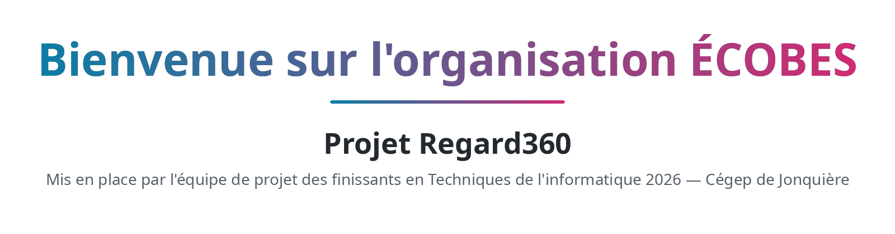
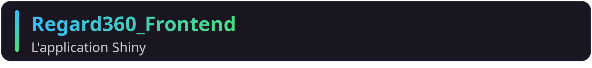
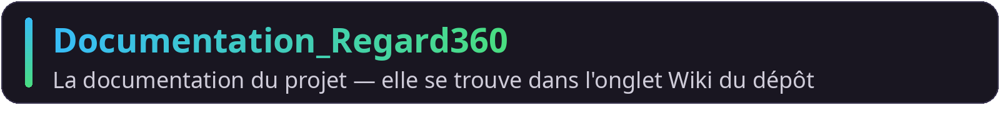
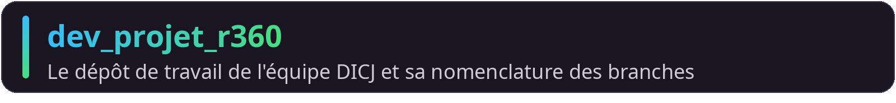
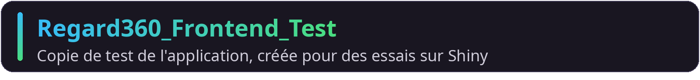
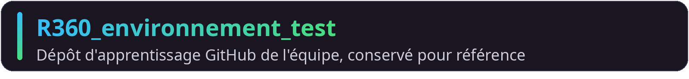
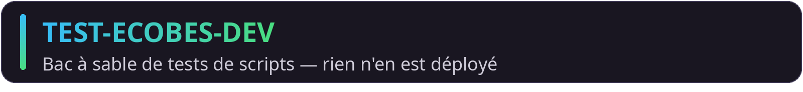

<picture>
  <source media="(prefers-color-scheme: dark)" srcset="assets/banniere-ecobes-sombre.png">
  <source media="(prefers-color-scheme: light)" srcset="assets/banniere-ecobes-claire.png">
  
</picture>

Ici, vous trouverez les différents projets qui font partie de cette organisation.

---

<h2 align="center">Que souhaitez-vous faire ?</h2>

---

<h2 align="center">Les dépôts du projet</h2>

<a href="https://github.com/CDJ-Ecobes/Regard360_Frontend"><picture><source media="(prefers-color-scheme: dark)" srcset="assets/carte-frontend.png"><source media="(prefers-color-scheme: light)" srcset="assets/carte-frontend-claire.png"></picture></a>

<a href="https://github.com/CDJ-Ecobes/Regard360_Scripts_R"><picture><source media="(prefers-color-scheme: dark)" srcset="assets/carte-scripts.png"><source media="(prefers-color-scheme: light)" srcset="assets/carte-scripts-claire.png"></picture></a>

<a href="https://github.com/CDJ-Ecobes/Documentation_Regard360"><picture><source media="(prefers-color-scheme: dark)" srcset="assets/carte-documentation.png"><source media="(prefers-color-scheme: light)" srcset="assets/carte-documentation-claire.png"></picture></a>

<a href="https://github.com/CDJ-Ecobes/dev_projet_r360"><picture><source media="(prefers-color-scheme: dark)" srcset="assets/carte-dev-projet.png"><source media="(prefers-color-scheme: light)" srcset="assets/carte-dev-projet-claire.png"></picture></a>

---

<h2 align="center">Les dépôts de test</h2>

<em>Ces dépôts servent aux essais et à l'apprentissage de l'équipe de développement.</em>

<a href="https://github.com/CDJ-Ecobes/Regard360_Frontend_Test"><picture><source media="(prefers-color-scheme: dark)" srcset="assets/carte-frontend-test.png"><source media="(prefers-color-scheme: light)" srcset="assets/carte-frontend-test-claire.png"></picture></a>

<a href="https://github.com/CDJ-Ecobes/R360_environnement_test"><picture><source media="(prefers-color-scheme: dark)" srcset="assets/carte-environnement-test.png"><source media="(prefers-color-scheme: light)" srcset="assets/carte-environnement-test-claire.png"></picture></a>

<a href="https://github.com/CDJ-Ecobes/TEST-ECOBES-DEV"><picture><source media="(prefers-color-scheme: dark)" srcset="assets/carte-test-ecobes-dev.png"><source media="(prefers-color-scheme: light)" srcset="assets/carte-test-ecobes-dev-claire.png"></picture></a>

---

<h2 align="center">Vous débutez sur GitHub ?</h2>

Des guides pas à pas ont été préparés pour vous : commencez par la page
**« Par où commencer ? »** du [Wiki de documentation](https://github.com/CDJ-Ecobes/Documentation_Regard360/wiki),
puis, au besoin, les tutoriels d'installation (R, RStudio, Git) du
[Wiki de Regard360_Scripts_R](https://github.com/CDJ-Ecobes/Regard360_Scripts_R/wiki).

---

