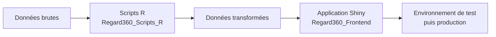

<div align="center">

# Bienvenue sur l'organisation ÉCOBES

**Regard360** · Application Shiny · Scripts R · Documentation


</div>

---

> [!NOTE]
> **Ici, vous trouverez les différents projets qui font partie de cette organisation,
> ainsi que les dépôts qui les composent et le rôle de chacun.**

Voici les différents dépôts du projet **Regard360**, mis en place par l'équipe de projet
des **finissants en Techniques de l'informatique — 2026**, du Cégep de Jonquière,
en collaboration avec ÉCOBES.

Cette page est votre point d'entrée : elle vous présente chaque dépôt, à quoi il sert
et par où commencer, que vous souhaitiez simplement consulter le projet ou y contribuer.

---

## Sommaire

- [Les dépôts du projet Regard360](#les-dépôts-du-projet-regard360)
- [Le projet en un coup d'œil](#le-projet-en-un-coup-dœil)
- [Vous débutez sur GitHub ?](#vous-débutez-sur-github-)
- [Conventions de travail](#conventions-de-travail)
- [Besoin d'aide ?](#besoin-daide-)

---

## Les dépôts du projet Regard360

| Dépôt | À quoi il sert |
|---|---|
| **[Regard360_Frontend](https://github.com/CDI-Ecobes/Regard360_Frontend)** | L'application Shiny Regard360 |
| **[Regard360_Scripts_R](https://github.com/CDI-Ecobes/Regard360_Scripts_R)** | Les scripts R de traitement des données |
| **[Documentation_Regard360](https://github.com/CDI-Ecobes/Documentation_Regard360)** | La documentation du projet, dans le Wiki |
| **[dev_projet_r360](https://github.com/CDI-Ecobes/dev_projet_r360)** | Le dépôt de travail de l'équipe de projet |

<details>
<summary><strong>Regard360_Frontend — l'application</strong></summary>

<br>

C'est le dépôt principal de l'application Shiny Regard360
(dossier `V_collab_info`, fichier principal `app.R`).

- Un envoi de code sur la branche `Dev` déclenche automatiquement
  le déploiement vers l'environnement de test (*staging*).
- Les changements y sont donc vérifiés avant toute mise en production.
- Tout nouveau développement commence dans une branche `feature/…`
  et rejoint `Dev` par une demande de fusion (*pull request*).

</details>

<details>
<summary><strong>Regard360_Scripts_R — le traitement des données</strong></summary>

<br>

Ce dépôt regroupe les scripts R qui préparent et transforment
les données utilisées par l'application.

- C'est ici que se fait le cheminement des données brutes
  vers les données transformées.
- Son **Wiki** propose des tutoriels détaillés pour les personnes
  qui travaillent avec R et RStudio : installation des outils,
  récupération du projet sur un poste de travail et marche à suivre
  pour proposer des modifications.

</details>

<details>
<summary><strong>Documentation_Regard360 — la documentation</strong></summary>

<br>

Le dépôt en lui-même contient peu de fichiers, et c'est normal :
**la documentation se trouve dans son onglet Wiki**.

Vous y trouverez notamment :

- la page **« Par où commencer ? »**, avec la vue d'ensemble du projet ;
- l'installation et la configuration des outils ;
- la façon de cloner un dépôt, de créer ou de changer de branche
  et de fusionner une branche ;
- les conventions de nommage et le fonctionnement des branches ;
- une foire aux questions.

> [!TIP]
> Si vous ne visitez qu'un seul endroit avant de commencer, que ce soit celui-ci :
> **Documentation_Regard360 → Wiki → « Par où commencer ? »**

</details>

<details>
<summary><strong>dev_projet_r360 — le dépôt de l'équipe</strong></summary>

<br>

Dépôt de l'équipe de projet DICJ, automne 2026.

- Il porte la **nomenclature officielle des branches** du projet.
- Plusieurs branches d'équipe y cohabitent : avant d'y travailler,
  vérifiez dans quelle branche vous vous trouvez.

</details>

---

## Le projet en un coup d'œil



> Les scripts transforment les données, l'application les présente,
> et la documentation explique l'ensemble du cheminement.

---

## Vous débutez sur GitHub ?

> [!IMPORTANT]
> GitHub peut sembler intimidant au premier abord, particulièrement lorsqu'on
> n'y travaille pas au quotidien. Des guides pas à pas ont été préparés
> précisément pour vous accompagner.

Si vous souhaitez vous familiariser avec la plateforme, ou simplement
effectuer une première opération, nous vous suggérons ce parcours :

1. **La vue d'ensemble** — la page « Par où commencer ? »
   du Wiki de Documentation_Regard360
2. **L'installation des outils** — les tutoriels du Wiki de
   Regard360_Scripts_R (R, RStudio et Git), étape par étape
3. **Les manipulations de base** — cloner un dépôt, travailler
   sur une branche, proposer une modification
4. **La foire aux questions** — du Wiki de Documentation_Regard360,
   si un point précis vous bloque

Il n'est pas nécessaire de maîtriser GitHub pour consulter les dépôts :
la lecture et la navigation sont libres pour les membres ayant accès
à l'organisation.

<details>
<summary><em>À propos des dépôts de test</em></summary>

<br>

Vous remarquerez également trois dépôts dont le nom contient le mot *test* :
`Regard360_Frontend_Test`, `R360_environnement_test` et `TEST-ECOBES-DEV`.

Ils servent uniquement aux essais et à l'apprentissage de l'équipe
de développement et ne contiennent pas les versions officielles du projet.
Si vous venez consulter ou utiliser Regard360, référez-vous plutôt
aux dépôts présentés plus haut.

</details>

---

## Conventions de travail

| Branche | Rôle |
|:---|:---|
| `main` | Version testée et fonctionnelle du projet |
| `Dev` | Branche d'intégration — tests et déploiement vers l'environnement de test |
| `feature/nom-du-billet-raccourci` | Développement d'une fonctionnalité ou d'une correction |

```text
feature/… ──► pull request ──► Dev ──► tests / staging ──► main
```

> [!WARNING]
> Aucun mot de passe, aucune clé d'accès et aucun fichier `.env`
> ne doivent être déposés dans ces dépôts.

---

## Besoin d'aide ?

Si vous éprouvez une difficulté, si vous ne trouvez pas l'information
recherchée ou si un accès semble manquant, nous vous invitons à communiquer
avec l'équipe du projet. Il nous fera plaisir de vous orienter.

*[Coordonnées de la personne-ressource à confirmer avant publication.]*

---

<div align="center">

*Page d'accueil de l'organisation ÉCOBES — projet Regard360*
*Équipe de projet des finissants en Techniques de l'informatique, Cégep de Jonquière — 2026*

</div>
